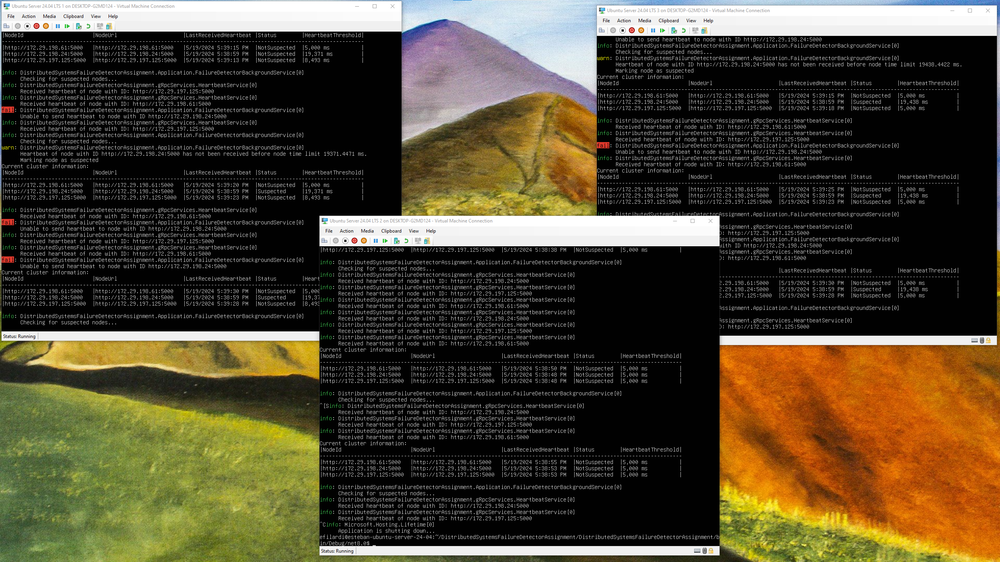

# DistributedSystemsFailureDetectorAssignment

Assignment for a course on Distributed Systems and Virtualization. Assignment involved implementing a failure detection algorithm for a cluster of nodes in which every node is client and server at the same time.

## How to Build Application

.NET 8 SDK is required.

`dotnet build`

## How to Run Application

`.\DistributedSystemsFailureDetectorAssignment.exe --urls "http://localhost:5000" --HeartbeatPropagationIntervalMs 5000 --FailureDetectorCheckingIntervalMs 7000 --Cluster:DefaultNodeElapsedTimeThresholdMs 5000`

Application parameters can also be defined in the `appsettings.json` file. You can specify the nodes of the cluster either in the `appsettings.json` file or as command line parameters. For example:

`.\DistributedSystemsFailureDetectorAssignment.exe --urls "http://localhost:5000" --Cluster:Nodes:0:NodeUrl http://localhost:5001 --Cluster:Nodes:1:NodeUrl http://localhost:5002`

